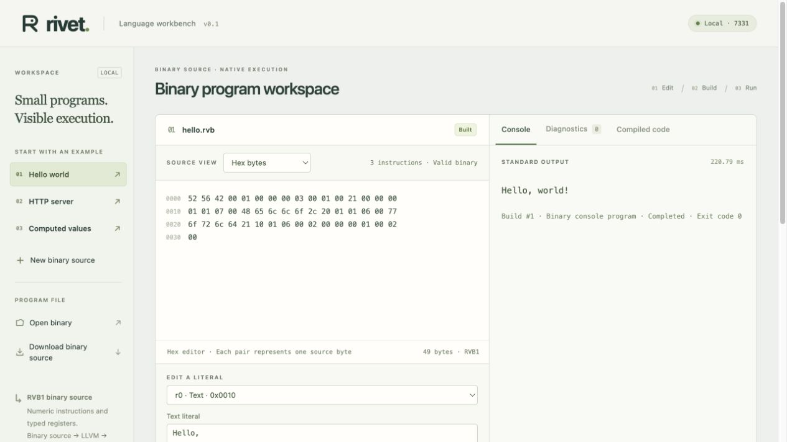

# Rivet

[](https://github.com/mrmcgrewx/rivet-lang/actions/workflows/ci.yml)

**An experimental binary programming language for machine-authored programs, with native compilation and a graphical inspector.**

Rivet programs are authored as **binary `.rvb` source files**. Numeric opcodes, type tags, register references, and byte payloads define the program. The compiler decodes those bytes directly, validates them, and produces a standalone native executable through LLVM and Clang.

A local browser workbench provides the human interface: decode the source, inspect its bytes, edit values, build, and run. The readable view is generated from the binary file. JSON and textual assembly are not required source formats.

**Status:** experimental prototype. Binary console programs and local HTTP services target **macOS on Apple Silicon**. AI-generation reliability and efficiency remain research questions.

## Source is binary; output is native

| File | Role |
| --- | --- |
| [`examples/hello.rvb`](examples/hello.rvb) | The authored program: 49 bytes of RVB1 instructions and entry data. |
| `hello` | The native executable produced from that source. |
| `hello.ll`, `hello.s`, `hello.build.json` | Optional inspection files produced during compilation. |

Opening `hello.rvb` in a text editor does not reveal textual source code. Its text literals may still be recognizable: binary encoding is not encryption. The compiler and GUI understand the numeric instruction format; a person can inspect it using the same decoder.

The committed examples are written directly from opcode bytes, without compiling JSON into them. [`scripts/write_binary_examples.py`](scripts/write_binary_examples.py) is an optional reproducibility tool for writing those bytes, not a program needed to execute the examples. The `.rvb` files are the source of truth.

## Quick start

### Requirements

- **macOS on Apple Silicon** — the verified native target.
- **Rust via [rustup](https://rustup.rs/)** — Rust 1.90.0 is pinned.
- **Apple's Xcode command-line tools** — install with `xcode-select --install` if needed. Native builds require Clang; verification uses Apple Clang 17.0.0.

```sh
git clone https://github.com/mrmcgrewx/rivet-lang.git
cd rivet-lang
cargo build --release --locked
./target/release/rivet build examples/hello.rvb -o ./hello
./hello
```

Output:

```text
Hello, world!
```

`hello` is an arm64 Mach-O executable. It runs without Rivet, Clang, the source file, inspection files, or a workbench process; on the verified target it links only to the macOS system library. Existing output files are not overwritten: choose another output path when rebuilding. `RIVET_CLANG` can select another compiler executable.

### Inspect the source

```sh
./target/release/rivet inspect examples/hello.rvb
xxd -g 1 examples/hello.rvb
```

The first command decodes a readable view. The second displays the actual source bytes in hexadecimal:

```text
52 56 42 00 01 00 00 00 03 00 01 00 21 00 00 00
01 01 07 00 48 65 6c 6c 6f 2c 20 01 01 06 00 77
6f 72 6c 64 21 10 01 06 00 02 00 00 00 01 00 02
00
```

These are 49 binary bytes, not a file containing hexadecimal text. They define two text values, a concatenation, and a console entry. The full [binary format specification](docs/BINARY-FORMAT.md) defines every byte, including the header, numeric operations, operand layout, and error rules. It includes direct binary authoring instructions.

### Browser workbench

```sh
./target/release/rivet ui
```

Open [localhost:7331](http://127.0.0.1:7331/). Load **Hello world** or open a `.rvb` file, inspect its decoded instructions and raw hex bytes, then **Build** and **Run executable**.

The workbench supports binary source import/download, scalar literal editing, HTTP port editing, raw byte editing, byte-offset diagnostics, and inspection of typed IR, LLVM, and native assembly. Builds expose an executable path and download. Server controls show the native process and make real HTTP requests.

**Download source** saves binary `.rvb` bytes. **Download executable** saves the compiled native program. Source edits, accepted builds, and running servers have separate state; editing or rebuilding does not change a running server. Executable artifacts persist under `.rivet/builds/` after the workbench closes. Save source before reload; the editor and UI build history are held in memory. Downloaded executable copies may need `chmod +x rivet-program`.

Use `./target/release/rivet ui --port 0` for an available port. Ctrl-C or SIGTERM stops the workbench and its managed server.

### Standalone HTTP server

The 64-byte [`server.rvb`](examples/server.rvb) defines its values, JSON object, port, route, and response status in binary:

```sh
./target/release/rivet build examples/server.rvb -o ./server
./server
```

In another terminal:

```sh
curl -i http://127.0.0.1:8787/hello
```

It returns status `200`, content type `application/json; charset=utf-8`, and `{"message":"hello world"}`. Ctrl-C stops the independent server. The GUI can set port `0` to select an available port.

[`computed.rvb`](examples/computed.rvb), at 159 bytes, exercises checked arithmetic, conversion, concatenation, booleans, and nested JSON. Its `/computed` route returns the computed result. JSON is an output data type here, not the program source.



## Language design

RVB1 is a typed, single-assignment instruction stream representing an acyclic dataflow graph. Each instruction's position defines a numeric register. Operands refer to earlier registers; no source names or textual opcodes are stored.

The four types are `Text`, signed 64-bit `Int`, `Bool`, and `Json`. Seven numeric operations create literals, concatenate text, add integers with overflow checks, convert scalar values to text, and construct objects. An entry record selects console output or an HTTP service. Instructions are evaluated in order, including unused instructions that can fail.

The format makes structure explicit and compact. Fixed-width numeric references and length-delimited records support mechanical construction, inspection, and edits. The decoder checks the version, lengths, types, references, UTF-8, canonical field ordering, and resource bounds before native compilation. There is no intermediate JSON source document, embedded text program, or required assembler.

The representation is intended for AI authorship. Its numeric structure alone does not establish better model accuracy or token efficiency; those require separate experiments. See [language semantics](docs/LANGUAGE.md) and [architecture](docs/ARCHITECTURE.md).

## Compilation and runtime

```text
Binary .rvb source → direct decoding and validation → typed IR → LLVM → native executable
```

Rust implements the decoder, validator, compiler driver, and workbench. LLVM/Clang performs optimization and machine-code generation. Generated code implements program operations and entry configuration; linked C helpers supply immutable text/JSON handling, allocation, formatting, output, and HTTP transport. Native executables contain no Rivet source parser or instruction interpreter.

A reference interpreter executes the validated typed IR for correctness comparisons. The original JSON frontend is retained only as a legacy library/test fixture path; CLI Build/Run/Inspect and the GUI accept binary source and reject JSON source. JSON control messages and HTTP responses are separate from program files.

## Command-line reference

Use `./target/release/rivet` from the checkout, or place the binary on PATH. All source commands consume `.rvb` bytes.

| Command | Behavior |
| --- | --- |
| `rivet build FILE -o PATH [--profile size\|baseline]` | Compile binary source to a native executable and inspection files. |
| `rivet run FILE` | Build a persistent native artifact and launch it. |
| `rivet inspect FILE` | Decode and validate binary source, then print a readable view. |
| `rivet check FILE` | Validate source and print typed IR; equivalent inspection path. |
| `rivet interpret FILE` | Decode binary source and execute the reference interpreter. |
| `rivet ui [--port PORT]` | Start the local workbench; default port 7331. |

## Development and validation

From the repository root, with Rust, Clang, and Python 3:

```sh
cargo fmt --check
cargo clippy --locked --all-targets -- -D warnings
cargo test --locked
python3 tests/native_runtime/run.py
python3 tests/native_runtime/run.py --sanitize undefined
```

Browser tests require Node.js 22 or newer:

```sh
npm ci
npx playwright install chromium
npm test
```

The workbench itself needs no Node.js or frontend build. Binary tests cover malformed/truncated inputs, canonical roundtrips, types and references, decoded offsets, native/reference agreement, binary import/export/editing, and independent executables. See [current validation](docs/BINARY-VALIDATION.md) for recorded results.

The native optimization objective remains executable file size. `size` uses Clang `-Oz` plus linker dead stripping; `baseline` uses identical generated LLVM and support at `-O0`. Run `python3 scripts/native_benchmark.py` after building the release compiler to compare the binary examples. [Measurements from the binary examples](docs/BINARY-BENCHMARK.json) show 5.4% smaller Hello, 0.65% smaller server, and a tie for computed output, with slower builds. These are small-workload native size results, not evidence of AI-generation or binary-decoding efficiency.

## Scope

The current language has no user-defined branches, loops, functions, persistent storage, or request-dependent values. HTTP responses are computed at startup. Binary source is limited to 64 KiB, with at most 256 instructions and 32 routes; [exact value and transport bounds](docs/LANGUAGE.md#resource-limits) are documented separately.

HTTP is a local experimental subset: IPv4 loopback, exact GET routes, sequential connections, bounded parsing, and a two-second read deadline. TLS, chunked bodies, streaming, and production deployment are outside this prototype. Only macOS Apple Silicon is verified; cross-compilation, universal binaries, and distribution signing are not provided. Native machine-code emission uses LLVM/Clang, while RVB1 is Rivet's custom binary source format.

## Documentation

- [Binary format and authoring](docs/BINARY-FORMAT.md)
- [Language semantics](docs/LANGUAGE.md)
- [Architecture and runtime boundary](docs/ARCHITECTURE.md)
- [Binary-source validation](docs/BINARY-VALIDATION.md)
- [Project state and history](docs/STATE.md)
