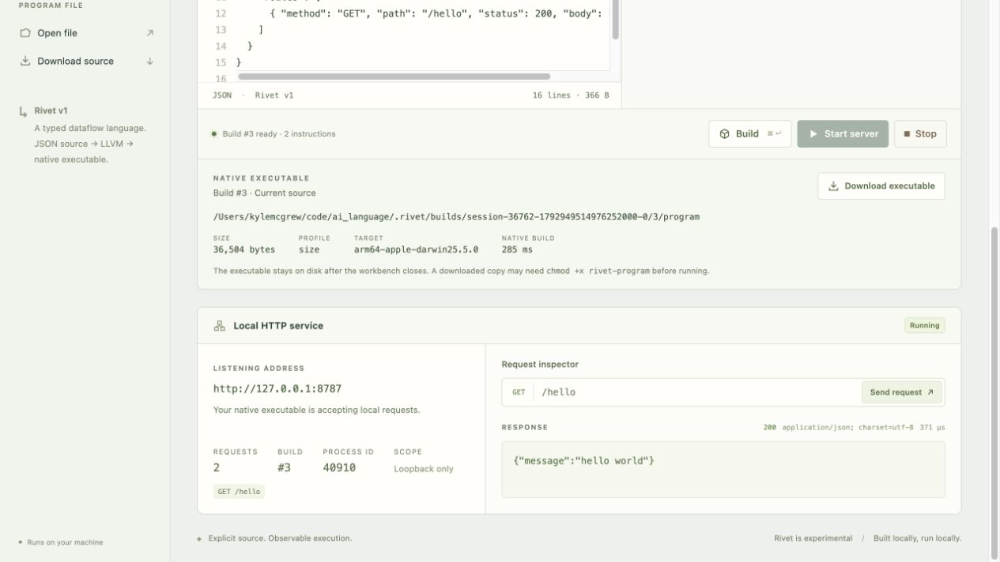

# Rivet

[](https://github.com/mrmcgrewx/rivet-lang/actions/workflows/ci.yml)

**An experimental programming language for structured, AI-generated programs, compiled to standalone native executables.**

Rivet explores a small language that AI systems can construct and modify through explicit operations, types, and dependencies. Programs are represented as typed dataflow graphs, serialized as JSON, and compiled through LLVM and Clang. A local browser workbench makes the source, generated code, and execution visible to developers.

**Status:** v0.1 experimental prototype. Console programs and local HTTP services are implemented and verified on **macOS with Apple Silicon**.

## Why Rivet?

The experiment centers on a question: what should a program representation look like when an AI system is its primary author?

Rivet's initial design emphasizes:

- **Local, structured edits.** Each instruction defines one named value. Stable IDs and explicit references let a tool replace a node or reconnect a dependency without rewriting unrelated instructions.
- **Validation before execution.** The compiler checks the schema, operand types, unique IDs, dependency order, entry definitions, and static resource limits. Arithmetic overflow and computed-value limits are checked during execution.
- **Inspectable native output.** Every build produces an executable, LLVM IR, assembly, and build metadata. A reference interpreter provides an independent execution path for comparing results.

JSON is the source encoding; Rivet defines the operations, types, evaluation rules, and effects. The representation remains readable by people. Its benefits for AI generation are a design hypothesis that has not yet been benchmarked against conventional languages.

## A Rivet program

The [Hello world example](examples/hello.rivet.json) defines two text values, concatenates them, and selects the result as console output:

```json
{
  "version": 1,
  "name": "Hello world",
  "instructions": [
    { "id": "greeting", "op": "text", "value": "Hello, " },
    { "id": "audience", "op": "text", "value": "world!" },
    { "id": "message", "op": "concat", "values": ["greeting", "audience"] }
  ],
  "entry": { "kind": "console", "value": "message" }
}
```

Instructions may reference earlier definitions. Values have one of four types: `Text`, signed 64-bit `Int`, `Bool`, or `Json`. The current operations are `text`, `int`, `bool`, `concat`, checked `add`, `to_text`, and `object`. Each instruction is evaluated once in source order, including unused instructions that can fail.

The [computed example](examples/computed.rivet.json) demonstrates arithmetic, explicit conversion, and nested JSON composition. See the [language specification](docs/LANGUAGE.md) for complete semantics and limits.

## Quick start

### Requirements

- **macOS on Apple Silicon** — the verified target.
- **Rust via [rustup](https://rustup.rs/)** — the repository pins Rust 1.90.0.
- **Apple's Xcode command-line tools** — install with `xcode-select --install` if needed. Native builds require Clang; validation used Apple Clang 17.0.0.

Clone the repository, build the compiler, and compile the example:

```sh
git clone https://github.com/mrmcgrewx/rivet-lang.git
cd rivet-lang
cargo build --release --locked
./target/release/rivet build examples/hello.rivet.json -o ./hello
./hello
```

Output:

```text
Hello, world!
```

`hello` is an arm64 Mach-O executable. It can run independently of the compiler, source files, repository, and workbench; its only dynamic dependency on the verified target is the macOS system library.

Build also writes `hello.ll`, `hello.s`, and `hello.build.json` beside the executable. These files support inspection and are not needed to run it. Existing output files are never overwritten; choose a new output path for subsequent builds. Set `RIVET_CLANG` to select another Clang executable.

### Browser workbench

```sh
./target/release/rivet ui
```

Open [localhost:7331](http://127.0.0.1:7331/). Select **Hello world**, edit the source, choose **Build**, then **Run executable**.

The workbench provides:

- Source editing, example programs, file import, and source download.
- Build diagnostics and inspection of typed IR, LLVM IR, and assembly.
- Executable paths, sizes, targets, and downloads.
- Console output and process exit status.
- Server start/stop controls, process IDs, and a real HTTP request inspector.



Source edits, builds, and running servers have separate state: rebuilding does not change an already running service. Artifacts persist under `.rivet/builds/` after the workbench closes. Save source before reloading; the editor and UI build history are held in memory. Downloaded executable copies may need `chmod +x rivet-program`.

Use `./target/release/rivet ui --port 0` to select a free port. Ctrl-C or SIGTERM stops the workbench and its managed server.

### Standalone HTTP server

The [server example](examples/server.rivet.json) defines its port, route, status, and JSON response in Rivet:

```sh
./target/release/rivet build examples/server.rivet.json -o ./server
./server
```

From another terminal:

```sh
curl -i http://127.0.0.1:8787/hello
```

The response has status `200`, content type `application/json; charset=utf-8`, and body:

```json
{"message":"hello world"}
```

The server uses the same native compilation path as the console example. It runs independently and stops on Ctrl-C. Change the program's port to `0` to request an available port. Route bodies are computed at startup; request-dependent computation is outside the current language.

## How compilation works

```text
Rivet source → validation → typed IR → LLVM IR → Clang → native executable
```

| Component | Responsibility |
| --- | --- |
| Rust compiler | Parse source, validate the program, resolve references, and emit LLVM IR. |
| LLVM / Clang | Optimize, generate machine code, and link the executable. |
| Generated program | Execute operations, check arithmetic overflow, and configure console or HTTP entry behavior. |
| Linked C support | Manage immutable text/JSON values, formatting, allocation, output, sockets, and bounded HTTP transport. |
| Reference interpreter | Execute validated IR for semantic comparison and testing. |

Generated LLVM uses checked arithmetic and direct calls to native helpers. Executables contain no Rivet source parser or instruction interpreter. The compiler preserves operation order and observable failures through lowering. Detailed design decisions and the runtime boundary are documented in [Architecture](docs/ARCHITECTURE.md).

## Command-line reference

Use `./target/release/rivet` from the checkout, or place the binary on your PATH.

| Command | Behavior |
| --- | --- |
| `rivet build FILE -o PATH [--profile size\|baseline]` | Produce a native executable and inspection files. |
| `rivet run FILE` | Build a persistent native artifact and launch it. |
| `rivet check FILE` | Validate source and print typed IR without executing. |
| `rivet interpret FILE` | Execute through the reference interpreter. |
| `rivet ui [--port PORT]` | Start the local workbench; default port is 7331. |

## Performance measurements

The initial optimization objective is **executable file size**. The default `size` profile uses Clang `-Oz` and linker dead-code stripping. The `baseline` profile uses identical LLVM and C support at `-O0` without requested dead stripping.

Measured on macOS 26.5.2 / Apple Silicon with Apple Clang 17.0.0, using three builds per example and profile:

| Example | Baseline bytes | Size-profile bytes | Reduction |
| --- | ---: | ---: | ---: |
| Hello world | 36,744 | 34,760 | 5.40% |
| HTTP server | 36,744 | 36,504 | 0.65% |
| Computed values | 36,744 | 36,744 | 0.00% |

The size profile took longer to build in all three cases. These small workloads establish an initial comparison, not broad claims about execution speed, memory use, or compiler superiority. [Raw measurements](docs/NATIVE-BENCHMARK.json) and [methodology](docs/NATIVE-VALIDATION.md#efficiency-experiment) include build timings and semantic checks.

To reproduce after building the release compiler:

```sh
python3 scripts/native_benchmark.py
```

## Development and testing

From the repository root, with Rust, Clang, and Python 3 available:

```sh
cargo fmt --check
cargo clippy --locked --all-targets -- -D warnings
cargo test --locked
python3 tests/native_runtime/run.py
python3 tests/native_runtime/run.py --sanitize undefined
```

Browser tests additionally require Node.js 22 or newer:

```sh
npm ci
npx playwright install chromium
npm test
```

Node.js is only needed for browser tests; the workbench uses embedded HTML, CSS, and JavaScript with no frontend build step. Dependencies are pinned through the toolchain file and lockfiles.

The [validation record](docs/NATIVE-VALIDATION.md) documents 45 Rust tests, 10 Chromium scenarios, native runtime checks under both profiles and UBSan, and clean-checkout reproduction. Standalone-artifact tests run copied executables after workbench shutdown with the original artifact removed and no Rivet or compiler on PATH.

## Current scope

Rivet v0.1 implements bounded, straight-line programs. It has no user-defined branches, loops, functions, persistent storage, or request-dependent values. Programs support up to 256 instructions and 32 HTTP routes; source and computed text/JSON values have 64 KiB limits. The [language specification](docs/LANGUAGE.md#resource-limits) defines the exact bounds.

HTTP support is intended for local experiments: IPv4 loopback, exact GET routes, sequential connections, bounded request parsing, and a two-second read deadline. TLS, chunked request bodies, streaming, and production deployment are outside the current scope.

Only macOS on Apple Silicon is verified. Outputs target the build host; cross-platform compatibility, universal binaries, and distribution signing are not provided. Machine-code generation uses LLVM/Clang. AI-generation reliability and efficiency remain open research questions.

## Documentation

- [Language specification](docs/LANGUAGE.md) — source format, types, operations, effects, and limits.
- [Architecture](docs/ARCHITECTURE.md) — representation choices, compiler stages, and runtime responsibilities.
- [Native implementation contract](docs/NATIVE-PLAN.md) — ABI, artifact format, and execution interfaces.
- [Validation](docs/NATIVE-VALIDATION.md) — tests, reproducibility, benchmarks, and evidence.
- [Project state](docs/STATE.md) — milestone history and continuation context.
