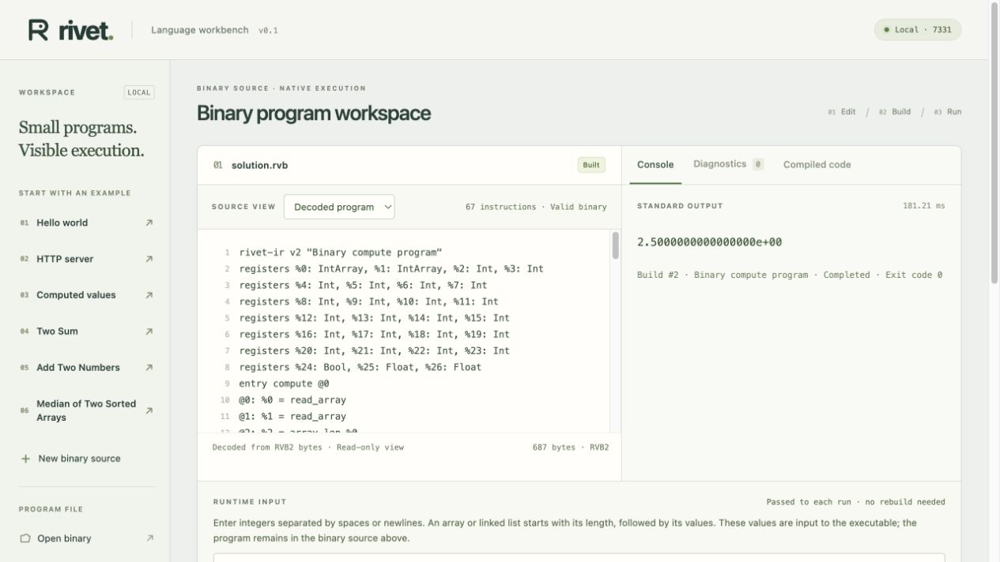

# Agent experiment validation

The controlled pilot is complete. Protocol: `b5066c8`; frozen harness/packets/corpora: `7461e96`; retained measured sources and raw results: `eb39fdcc02da90bc983193c823bf0f9c2f59aa4d`. All nine measured workers used `gpt-6-astra` / `xhigh` in fresh contexts. No production compiler, runtime, UI or existing example changed.

## Authoring and correctness

- Nine first submissions, all passing the ten-case development suite; zero retries and no post-pass source edits.
- All 878 frozen holdouts per language passed: 256 Two Sum, 264 Add Two Numbers and 358 Median, or 2,634 native checks.
- All 878 Rivet holdouts also passed the reference interpreter; all 878 C holdouts passed local UBSan.
- All 240 language/performance-case combinations passed standalone verification, and all 60 language/family/mode combinations passed preloaded verification before timing.
- Numeric session metadata, cumulative input/cache/output counters, completed status and scoped command audit were reconciled for every worker. No private session transcript or reasoning text was published.
- The independent reviewer verified all 988 corpus records against separate oracles, reconciled all 690 performance records and nine usage records, inspected 43 command-only calls, reproduced every byte writer exactly and passed 576 additional native cases. [Review](AGENT-EXPERIMENT-REVIEW.md): no blocking finding.

## Measurement

The original Apple M1 Pro/macOS 26.5.2 host produced 690 retained observations: 240 process samples including warmups, 30 calibrations and 420 preloaded evaluate/control samples. Seven measured samples per language/family are reported with raw values and min/median/max. Authoring workers, tests and profiling had stopped before timing. No control/startup subtraction was applied. Per-child `wait4` RSS is whole-process peak, not auxiliary solver memory. Model/agent sampling, cache and library/algorithm differences are disclosed in the [results](AGENT-EXPERIMENT-RESULTS.md).

## Clean public reproduction

A fresh public clone of `eb39fdc` at `/var/folders/_k/3wzd0z6167n5vrz21mh4p9n00000gp/T/rivet-authoring-clean-7v8or004/repo` passed:

```sh
cargo fmt --check
cargo clippy --locked --all-targets -- -D warnings
cargo test --locked
cargo build --release --locked
python3 tests/native_runtime/run.py
python3 tests/native_runtime/run.py --sanitize undefined
python3 experiments/agent-language-v1/test_harness.py -v
python3 experiments/agent-language-v1/evaluate.py \
  --sanitizer-mode undefined --output .rivet/clean-correctness.json \
  --build-root .rivet/clean-builds
python3 experiments/agent-language-v1/measure.py \
  --correctness .rivet/clean-correctness.json --verify-only \
  --output .rivet/clean-preloaded.json
npm ci
npx playwright install chromium
npm test
python3 scripts/write_binary_examples.py
git diff --exit-code -- examples/
```

Results: **100 Rust tests**, all baseline/size/speed native support checks, UBSan checks, all four reusable experiment harness suites and **18 browser scenarios** passed. All nine retained solutions rebuilt and passed the complete frozen holdouts, C UBSan, Rivet reference checks and 300 standalone/preloaded boundary-verification records. Existing examples regenerated byte-for-byte. Clean reproduction did not rerun or replace the original performance timing. A compact [reproduction record](../experiments/agent-language-v1/results/clean-reproduction.json) preserves the checked source hashes and outcomes.

## CI and sanitizer exception

Both public CI jobs passed for `eb39fdc`:

- [Verify Rivet — 40239460965](https://github.com/mrmcgrewx/rivet-lang/actions/runs/40239460965).
- [Agent experiment C safety — 40239461018](https://github.com/mrmcgrewx/rivet-lang/actions/runs/40239461018): all 878 C holdouts under ASan and UBSan on Ubuntu 24.04, Clang 18.1.3. The [machine-readable report](../experiments/agent-language-v1/results/ci-sanitizers.json) records the source hashes, compiler and individual outcomes.

Local Apple ASan startup hung even for an empty `main`. The [infrastructure note](AGENT-EXPERIMENT-INFRASTRUCTURE.md) records the before-main initialization trace and the stopped incomplete evaluation. This was not counted as a worker failure or retry. Local UBSan and separate CI ASan are explicitly distinguished; CI timings never enter the local performance comparison.

## Actual workbench verification

The live workbench on `127.0.0.1:7331` opened the retained median agent's actual `solution.rvb` through **Open binary**. It decoded 687 bytes / 67 operations, built and ran the program with `2 1 2 2 3 4`, and displayed `2.5000000000000000e+00`, completed with exit code zero. Switching from hex to the decoded view preserved the source and native result.

The workbench's normal size-profile executable is 35,352 bytes at `.rivet/builds/session-55181-1792963433316003000-0/2/program`; the speed-profile benchmark uses its separate 34,808-byte artifact. UI latency is not a benchmark sample. The tab is retained for inspection.



The pilot has no remaining acceptance blocker. Its narrow, single-sample conclusions and infrastructure exception remain part of the published evidence.
