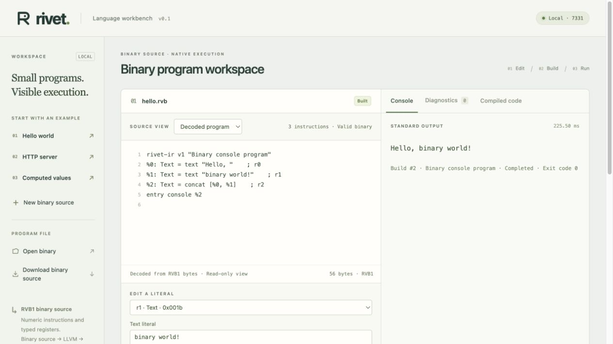
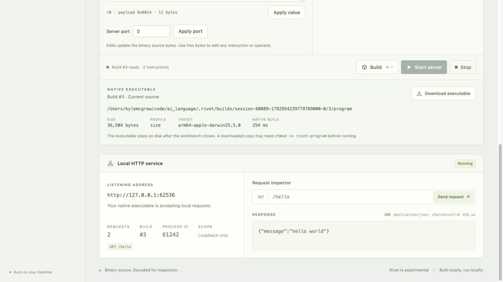

# Binary-source validation

Date: 2026-10-25. Current source contract: RVB1 (`BINARY-FORMAT.md`). This supersedes JSON-source acceptance. Native runtime/backend tests remain relevant, but public source paths now require binary bytes.

## Authored files and compiler path

The tracked files `examples/hello.rvb` (49 bytes), `server.rvb` (64 bytes), and `computed.rvb` (159 bytes) contain real RVB1 records. `scripts/write_binary_examples.py` authors opcode bytes directly; it neither reads JSON nor invokes a textual source compiler. Git treats `.rvb` as binary. JSON fixtures live only under `tests/fixtures/legacy/` for legacy frontend regression tests.

`compile_binary` validates byte records and directly constructs private typed IR. No JSON parsing or textual assembly occurs on that path. CLI Build/Run/Inspect/Check/Interpret load binary bytes. Workbench examples are raw binary downloads; Build and Inspect receive application/octet-stream bodies. The API retains JSON for control messages and decoded metadata, not for source. The native pipeline remains LLVM/Clang with linked C support.

## Integrated checks

Performed on macOS 26.5.2 arm64, pinned Rust 1.90.0 and Apple Clang 17.0.0:

- `cargo fmt --check`: passed.
- `cargo clippy --locked --all-targets -- -D warnings`: passed.
- `cargo test --locked`: **59 tests passed** (13 binary-source, 24 legacy language semantics, 8 native codegen, 5 native artifact/CLI, 4 workbench, 3 HTTP transport, 2 reference runtime).
- `cargo build --release --locked`: passed.
- `python3 scripts/native_benchmark.py --report .rivet/binary-benchmark.json`: all 18 native builds and output checks passed, with identical LLVM between size/baseline profiles for each example.

Binary tests cover direct byte authoring, every truncated prefix, invalid magic/version/flags/reserved fields/body length, invalid opcode/result type/payload length/bools/UTF-8, forward/self/missing/wrong-type operands, key ordering/duplicates, HTTP routes/status/path bounds, file/literal/instruction limits, exact scalar/offset inspection, canonical encode/decode, and 6,000 random/mutated inputs. Native/reference comparisons exercise Hello, an all-operation HTTP program and runtime overflow under both profiles. Inspection does not execute the program.

API tests fetch example bytes exactly, inspect offsets, edit raw text payloads, reject JSON and oversized source, retain running servers through invalid builds, and check stale IDs/local-origin controls. Native artifact tests now start from binary examples; copied executables run after workbench shutdown with original artifacts removed and no compiler/Rivet on PATH. CLI tests additionally reject legacy JSON as source and verify readable binary inspection.

`npm test`: **12 real Chromium scenarios passed** in the UI owner's final integrated run. This includes exact `.rvb` import/export, raw-byte build payloads, decoded/scalar/port/hex edits, incomplete/invalid source, JSON rejection, exact i64 edits, native downloads/code views, HTTP lifecycle, and compact layout. No mocked compiler is used. Details: `BINARY-UI-HANDOFF.md`.

Independent review found and resolved one hex gutter offset display bug. No unresolved blocker remains. Additional review checked 99,915 mutation/truncation cases without panic; accepted variants roundtripped exactly. Twelve directly authored all-opcode binary programs produced 24 native builds across both profiles matching repeated reference HTTP bytes. Three separate browser probes confirmed stale success/error inspection responses cannot overwrite newer edits, invalid hex disables build/run/source export, and malformed but complete bytes are exported/built as themselves. See `BINARY-REVIEW.md`.

## Actual browser acceptance

The coordinator restarted the release workbench on port 7331 and used the actual in-app browser. The binary Hello loaded as 49 bytes, displayed its decoded three-instruction graph and hex source, compiled, and emitted exact `Hello, world!` with exit code 0. Editing the second literal to `binary world!` through the decoded inspector changed the source to 56 bytes; a new build emitted `Hello, binary world!`. Download binary source was exercised; exact saved-file bytes are separately verified by the browser suite.




The binary HTTP example loaded as 64 bytes. Its port was changed to zero through the byte editor, then built and started as a distinct native PID. Two real inspector requests returned status 200, JSON content type and exact `{"message":"hello world"}`. Stop released the native listener. The original JSON editor was replaced; the GUI labels decoded source as read-only and saves actual binary source independently from executable downloads.



Clean public checkout reproduction follows this integrated checkpoint.

## Measurements

Source sizes are 49/64/159 bytes; this is compact binary representation, not evidence of improved AI generation. Native-size experiment: identical generated LLVM and support; baseline -O0, candidate -Oz plus linker dead stripping. Three builds per profile; timing spans CLI launch through publication with the release compiler already built.

| Example | Baseline bytes | Size bytes | Reduction | Baseline median ms | Size median ms |
| --- | ---: | ---: | ---: | ---: | ---: |
| Hello | 36,744 | 34,760 | 5.40% | 191.446 | 252.022 |
| Server | 36,744 | 36,504 | 0.65% | 201.457 | 253.353 |
| Computed | 36,744 | 36,744 | 0.00% | 186.641 | 254.140 |

Raw samples: `BINARY-BENCHMARK.json`. The policy yields modest savings/tie and slower builds on these workloads. No model reliability, token efficiency, memory advantage, runtime-speed superiority or novel optimizer claim is made. Earlier `NATIVE-BENCHMARK.json` results remain historical.

## Reproduction

```sh
git clone https://github.com/mrmcgrewx/rivet-lang.git
cd rivet-lang
cargo fmt --check
cargo clippy --locked --all-targets -- -D warnings
cargo test --locked
cargo build --release --locked
python3 tests/native_runtime/run.py
python3 tests/native_runtime/run.py --sanitize undefined
npm ci
npx playwright install chromium
npm test
./target/release/rivet inspect examples/hello.rvb
./target/release/rivet build examples/hello.rvb -o .rivet/smoke/hello
.rivet/smoke/hello
./target/release/rivet ui
```

The native C support remains unchanged in this source correction. Prior strict warnings and UBSan passed; final clean-checkout verification reruns them. AddressSanitizer previously failed during host runtime initialization before main, and no ASan success is claimed. Only macOS arm64 is verified. User branches/loops/functions/request-dependent computation, distribution signing and broad performance studies remain outside this version.
