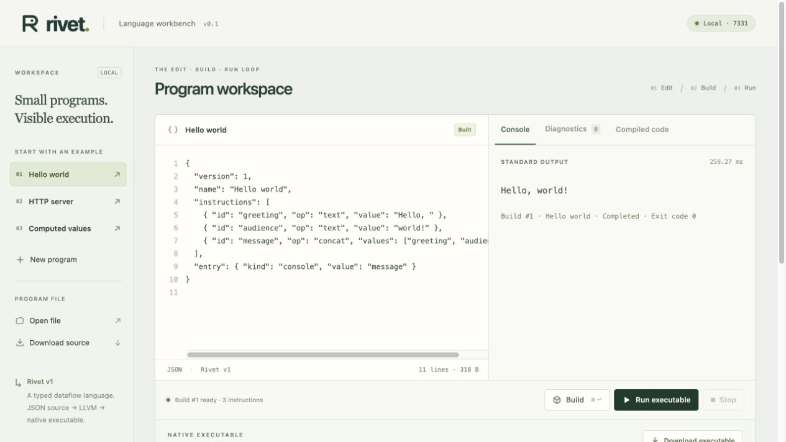
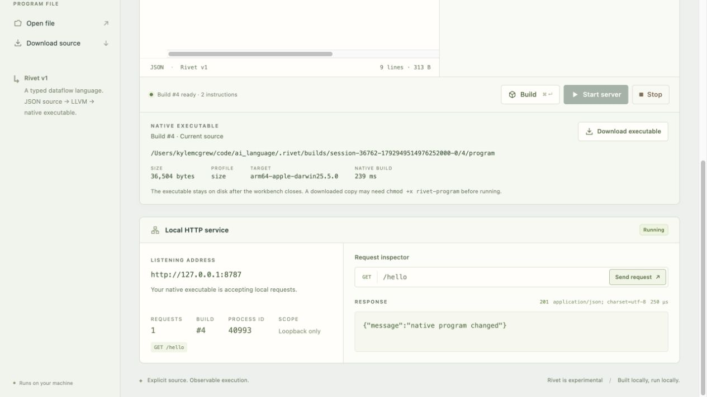
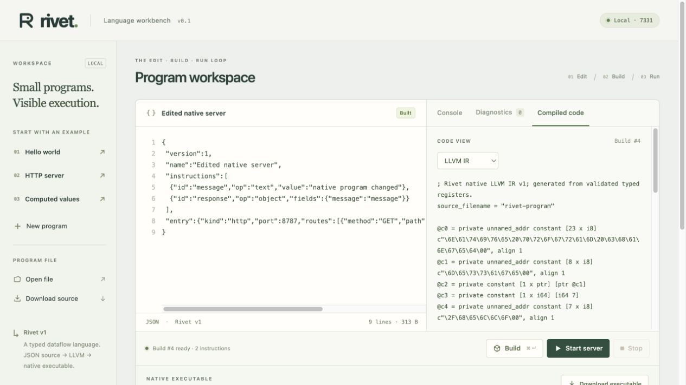

# Native milestone validation

**Binary-source update:** `BINARY-PLAN.md` and `BINARY-FORMAT.md` supersede JSON source and source API details here. Native backend/runtime evidence remains relevant; current end-to-end acceptance is recorded in `BINARY-VALIDATION.md`.

Date: 2026-10-25. This record supersedes interpreter-only completion in `VALIDATION.md`. Native executables are a required deliverable for both demonstrations.

## Environment and path

Verified on macOS 26.5.2 / Apple Silicon (arm64), Rust 1.90.0, Apple Clang 17.0.0 (`clang-1700.4.4.1`, target `arm64-apple-darwin25.5.0`), Xcode command-line SDK `/Library/Developer/CommandLineTools/SDKs/MacOSX.sdk`, Node 22.7.0, and locked Playwright 1.64.1 / Chromium.

Source → strict validation → typed indexed IR → direct LLVM → Clang object/link → Mach-O executable. Integer addition and failure branches are generated LLVM; native helpers handle immutable text/JSON, I/O and HTTP. No interpreter or source parser is embedded in an artifact. See `ARCHITECTURE.md` and `NATIVE-PLAN.md` for exact boundaries and rationale.

## Integrated automated results

Actually run on the integrated implementation:

| Command | Result |
| --- | --- |
| `cargo fmt --check` | Passed |
| `cargo clippy --locked --all-targets -- -D warnings` | Passed |
| `cargo test --locked` | 45 tests passed: 24 reference semantics, 8 native codegen/differential, 5 native artifact/CLI, 3 workbench, 3 HTTP transport, 2 reference runtime |
| `python3 tests/native_runtime/run.py` | Baseline and size profiles passed native values, limits, HTTP framing, partial requests, shutdown/rebind |
| `python3 tests/native_runtime/run.py --sanitize undefined` | UBSan passed |
| `npm test` | 10 real Chromium scenarios passed against native builds/children, no mocks |
| `cargo build --release --locked` | Passed |

Artifact tests verify native headers, download/file byte equality, both optimization profiles, exact JSON/i64/NUL/Unicode, backend errors, overwrite refusal, output changes, and process lifecycle. They copy the executable alone into an empty directory, close the workbench and managed child, remove the original artifact, clear the environment, and set PATH to a nonexistent directory. Both copied Hello and copied HTTP server run successfully. The standalone server handles five real requests and exits cleanly on SIGTERM.

Differential compiler tests cover all operations, empty values, checked positive/negative overflow (including unused nodes), first-failure order, output newline bounds, exact JSON bounds and escaped expansion. LLVM compilation itself is tested without executing a program during code generation. The independent reviewer additionally generated 12 programs and compared 24 native builds across both profiles to reference HTTP bytes. See `NATIVE-REVIEW.md`.

Review found workbench SIGTERM initially orphaned the child. Enabling termination signals and adding a CLI subprocess regression fixed it. Independent retesting with an incomplete request observed workbench exit 0, child disappearance, refused connections, native listener reuse, and preserved artifact. No unresolved implementation blocker remains. SIGKILL and crashes are outside graceful-shutdown guarantees.

AddressSanitizer could not initialize on this host (failure before main in the Apple ASan runtime); it is **not** counted as passing. Strict C warnings and UBSan did pass. These tests do not constitute a security audit or proof of all programs.

## Interactive browser evidence

The coordinator used the actual in-app browser against the rebuilt release workbench on port 7331, separately from Playwright. Hello built to a 34,760-byte arm64 artifact, Run printed exact `Hello, world!` with exit code 0, and changing source produced `Hello from a native Rivet program!` from a new 34,680-byte artifact. The UI exposed the persistent path and code views.



The HTTP example built through the same UI path to a 36,504-byte executable. Start exposed a distinct OS PID; two inspector requests returned status 200, JSON content type, and exact `{"message":"hello world"}`. Stop released the listener. Editing the program to status 201 and text `native program changed`, rebuilding, restarting and requesting returned the changed status/body from a new PID. Stop succeeded again. Typed IR and LLVM inspection reflected the edited route, payload and status. Browser tests separately check assembly and byte-exact executable download.






## Clean public checkout

Cloned `https://github.com/mrmcgrewx/rivet-lang.git` after pushing integrated checkpoint **`00116f95fee0bb6bac236d9d34974825c3131e41`**, into a new temporary directory. No `target/`, `node_modules/`, native artifacts, or application files were copied from the working checkout. The host's existing Rust toolchain, package download caches, and installed Chromium were available; this was a clean source/build tree, not a clean OS.

Ran the reproduction commands below through `npm test`: formatting and strict Clippy passed; all 45 Rust tests passed; release build passed; C baseline/size and UBSan passed; `npm ci` installed the locked dependencies; Chromium installation verification passed; all 10 browser scenarios passed in 12.5 seconds. The test workbench and children stopped afterward. `git status --porcelain` returned no tracked or untracked changes (ignored build outputs remained).

The clean release compiler then built Hello and server into `.rivet/smoke/`. `file` identified both as **Mach-O 64-bit executable arm64**; `otool -L` listed only `/usr/lib/libSystem.B.dylib` for each. Hello measured 34,760 bytes; server measured 36,504 bytes.

Copied just those two executable files into another empty temporary directory. With all environment variables cleared except `PATH=/nonexistent`, the copy of Hello emitted exact `Hello, world!` plus newline. The server copy answered three real requests with exact status/content type/body and exited zero on SIGTERM. No workbench from that clean clone was running during this smoke test. The stronger automated artifact tests additionally remove the original executable before running its copy after workbench shutdown.

The integrated checkpoint's [GitHub Actions run](https://github.com/mrmcgrewx/rivet-lang/actions/runs/40217317244) completed successfully: formatting/Clippy, Rust tests, native C/UBSan, and browser acceptance all passed on the independent macOS CI runner.

## Completion and usable local artifacts

Both corrected native milestones meet the acceptance contract. The final documentation commit records the clean-checkout evidence; it does not change production behavior from `00116f9`. Native core: `279dd92`; actual native UI acceptance/review/benchmark: `00116f9`; final evidence: the commit introducing this completion section.

The development checkout additionally contains ignored, ready-to-run `.rivet/deliverables/hello` and `.rivet/deliverables/server` with their sidecars. These are local outputs, not committed binaries. The workbench is available at `http://127.0.0.1:7331/` when its process is running. No program server was left running after interactive verification.

Remaining language features (loops/functions/branches/request data), aggregate memory budgets, handwritten emission, cross-platform verification, distribution signing, and broader performance/AI-generation studies are explicitly outside these completed milestones.

## Efficiency experiment

Primary objective: standalone executable file bytes. Baseline uses identical emitted LLVM and C support at `-O0` without requested linker dead stripping. Candidate uses `-Oz` and linker dead stripping. The benchmark asserts LLVM equality and verifies output/HTTP semantics for every sample. Three builds per profile/example; medians below. Build time spans CLI process launch through artifact publication, with the Rust compiler executable already built. It is not Rust bootstrap time or runtime request latency.

| Example | Baseline bytes | Size bytes | Reduction | Baseline build ms | Size build ms |
| --- | ---: | ---: | ---: | ---: | ---: |
| Hello | 36,744 | 34,760 | 5.40% | 193.564 | 252.019 |
| Server | 36,744 | 36,504 | 0.65% | 189.629 | 253.209 |
| Computed | 36,744 | 36,744 | 0.00% | 198.304 | 250.354 |

These are modest savings and a tie, with slower compilation. Small Mach-O files have layout/alignment overhead, and these results do not establish execution-speed, memory, model-generation, or broad compiler superiority. There is no novel optimizer claim. [Raw samples and host metadata](NATIVE-BENCHMARK.json) are committed. Reproduce with `cargo build --release --locked` then `python3 scripts/native_benchmark.py`; it writes a new report under ignored `.rivet/` by default.

## Reproduction commands

```sh
git clone https://github.com/mrmcgrewx/rivet-lang.git
cd rivet-lang
rustup show
clang --version
cargo fmt --check
cargo clippy --locked --all-targets -- -D warnings
cargo test --locked
cargo build --release --locked
python3 tests/native_runtime/run.py
python3 tests/native_runtime/run.py --sanitize undefined
npm ci
npx playwright install chromium
npm test
./target/release/rivet build examples/hello.rivet.json -o .rivet/smoke/hello
file .rivet/smoke/hello
otool -L .rivet/smoke/hello
.rivet/smoke/hello
./target/release/rivet ui
```

Build requires installed Clang/Xcode command-line tools. Launching the resulting artifact needs neither compiler. For repeated builds choose a new output name; overwrite refusal is intentional. Other platforms are not claimed verified.
